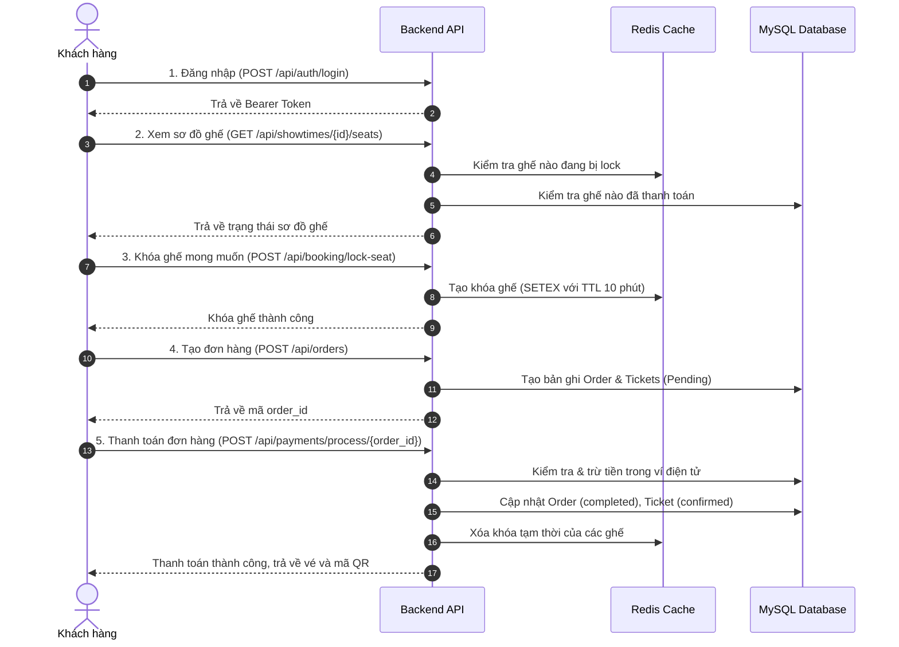

# 🎬 Cinema Booking System (Hệ Thống Đặt Vé Xem Phim)

Hệ thống backend API quản lý và đặt vé xem phim trực tuyến được xây dựng theo kiến trúc phân lớp (**Layered / Modular Architecture**), tích hợp cơ chế giữ ghế theo thời gian thực (**Real-time Seat Locking**) sử dụng **Redis** để chống tranh chấp vé (Race Condition), cùng cơ sở dữ liệu quan hệ **MySQL**.

---

## 📑 Mục lục
- [1. Tính năng chính](#1-tính-năng-chính)
- [2. Kiến trúc hệ thống](#2-kiến-trúc-hệ-thống)
- [3. Công nghệ sử dụng](#3-công-nghệ-sử-dụng)
- [4. Cấu trúc thư mục](#4-cấu-trúc-thư-mục)
- [5. Mô hình Cơ sở dữ liệu](#5-mô-hình-cơ-sở-dữ-liệu)
- [6. Hướng dẫn cài đặt & Khởi chạy](#6-hướng-dẫn-cài-đặt--khởi-chạy)
- [7. Danh sách API chính](#7-danh-sách-api-chính)
- [8. Luồng đặt vé & Thanh toán](#8-luồng-đặt-vé--thanh-toán)

---

## 1. Tính năng chính

### 👤 Quản lý người dùng (`User_management`)
* Đăng ký tài khoản, đăng nhập nhận Bearer Token an toàn.
* Xem thông tin cá nhân, cập nhật mật khẩu/họ tên.
* Quản lý ví điện tử (`wallet_balance`) và điểm tích lũy thành viên (`loyalty_points`).
* **Admin:** Quản lý toàn bộ người dùng, cấp tài khoản nhân viên quầy (`STAFF`).

### 🍿 Quản lý Phim & Lịch chiếu (`Catalog_and_showtime`)
* Tra cứu danh sách phim đang chiếu, chi tiết thời lượng, độ tuổi, trailer, poster.
* Danh mục cụm rạp, phòng chiếu (2D, 3D, IMAX).
* Tra cứu lịch chiếu lọc theo ngày chiếu (`date`), phim (`movie_id`) hoặc rạp (`cinema_id`).
* **Admin:** Thêm phim mới, thêm/xóa lịch chiếu.

### 💺 Sơ đồ ghế & Khóa ghế Realtime (`Booking_and_seat`)
* Tải sơ đồ ghế của suất chiếu với trạng thái trực quan: **Trống (Available)**, **Đang giữ (Locked)**, **Đã bán (Booked)**.
* **Cơ chế Distributed Lock bằng Redis:** Khóa tạm thời 1 hoặc nhiều ghế khi khách chọn trong 5 - 10 phút (TTL).
* Tự động giải phóng ghế khi hết thời gian giữ chỗ hoặc khi khách chủ động hủy, chống đặt trùng vé (Double-booking).

### 💳 Đơn hàng & Thanh toán (`Orders_and_payments`)
* Tạo đơn hàng (`Order`) từ các ghế đã được khóa thành công.
* Xử lý thanh toán trừ tiền trực tiếp qua số dư ví ảo của khách hàng.
* Chuyển trạng thái vé sang `confirmed` và tự động sinh mã QR (`qr_code_url`) vé điện tử.
* Tra cứu lịch sử đơn hàng và vé đã mua.

### 📊 Báo cáo & Thống kê (`Reports_and_Analytics`)
* Báo cáo doanh thu theo thời gian, theo rạp cho Quản trị viên.
* Báo cáo top các bộ phim bán chạy nhất.

---

## 2. Kiến trúc hệ thống

Hệ thống áp dụng mô hình kiến trúc phân lớp (**Layered Architecture**):

```
Client (Web / Mobile / Postman)
            │
            ▼
┌──────────────────────────────────────────────┐
│  Auth Middleware (app/middleware/auth.py)    │
│  - Xác thực Token tập trung (before_request) │
│  - Phân quyền (Role: CUSTOMER, STAFF, ADMIN) │
└──────────────────────┬───────────────────────┘
                       │
                       ▼
┌──────────────────────────────────────────────┐
│  Routes Layer (Blueprints)                   │
│  - Nhận HTTP Request, parse & validate input │
└──────────────────────┬───────────────────────┘
                       │
                       ▼
┌──────────────────────────────────────────────┐
│  Services Layer                              │
│  - Xử lý Business Logic, tính tiền, ví ảo   │
│  - Điều phối khóa ghế Redis (TTL 5 - 10 phút)│
└──────────────────────┬───────────────────────┘
                       │
                       ▼
┌──────────────────────────────────────────────┐
│  Repositories Layer                          │
│  - Tách biệt truy vấn dữ liệu (DB/Cache)    │
└──────────────┬───────────────────────────────┘
               │
       ┌───────┴───────┐
       ▼               ▼
┌──────────────┐ ┌──────────────┐
│ MySQL DB 8.0 │ │ Redis Cache  │
│ (Persistent) │ │ (Seat Locks) │
└──────────────┘ └──────────────┘
```

---

## 3. Công nghệ sử dụng

* **Ngôn ngữ & Framework:** Python 3, [Flask](https://flask.palletsprojects.com/)
* **ORM & Migration:** Flask-SQLAlchemy, Flask-Migrate (Alembic)
* **Cơ sở dữ liệu chính:** MySQL 8.0
* **Bộ nhớ đệm & Lock ghế:** Redis 7 (Alpine)
* **Công cụ quản trị CSDL:** Adminer
* **Ảo hóa & Triển khai:** Docker & Docker Compose

---

## 4. Cấu trúc thư mục

```
cinema_system/
├── app/
│   ├── __init__.py                # Khởi tạo Flask app, đăng ký Middleware & Blueprints
│   ├── docs.py                    # Swagger UI tại /api/docs
│   ├── models.py                  # Định nghĩa Models CSDL (SQLAlchemy)
│   ├── redis_client.py            # Singleton kết nối Redis
│   ├── security.py                # Sinh Bearer Token sau khi đăng nhập
│   ├── middleware/
│   │   └── auth.py                # Middleware xác thực & phân quyền tập trung
│   ├── repositories/
│   │   ├── booking_repository.py       # Truy vấn ghế, lịch chiếu, vé, đơn hàng
│   │   ├── seat_lock_repository.py     # Truy cập Redis (khóa/mở khóa ghế)
│   │   ├── analytics_repository.py     # Truy vấn tổng hợp báo cáo
│   │   └── user_repository.py          # Xử lý truy vấn người dùng
│   └── routes/
│       ├── User_management/       # APIs Đăng ký, Đăng nhập, Profile, Admin User
│       ├── Catalog_and_showtime/  # APIs Phim, Rạp, Lịch chiếu
│       ├── Booking_and_seat/      # APIs Sơ đồ ghế, Khóa/Mở khóa ghế
│       ├── Orders_and_payments/   # APIs Đơn hàng, Thanh toán, Lịch sử
│       └── Reports_and_Analytics/ # APIs Báo cáo thống kê (Admin)
├── API spec/
│   ├── user_management.yaml       # OpenAPI Spec: Người dùng & Xác thực
│   ├── booking_and_seat.yaml      # OpenAPI Spec: Sơ đồ ghế & Khóa/Mở khóa ghế
│   ├── orders_and_payments.yaml   # OpenAPI Spec: Đơn hàng & Thanh toán
│   ├── catalog_and_showtime.yaml  # OpenAPI Spec: Phim, Rạp & Lịch chiếu
│   └── reports_and_analytics.yaml # OpenAPI Spec: Báo cáo & Thống kê (Admin)
├── migrations/                    # File versioning CSDL qua Flask-Migrate
├── docker-compose.yml             # Cấu hình container MySQL, Redis, Adminer
├── requirements.txt               # Danh sách thư viện Python
├── seed.py                        # Script khởi tạo CSDL mẫu & tài khoản test
├── run.py                         # Điểm chạy ứng dụng
└── .env.example                   # Mẫu cấu hình biến môi trường
```

---

## 5. Mô hình Cơ sở dữ liệu

* **Users:** Quản lý tài khoản, mật khẩu băm, quyền hạn (`customer`, `staff`, `admin`), số dư ví, điểm tích lũy.
* **Cinemas:** Tên rạp, địa chỉ, hotline.
* **Rooms:** Phòng chiếu thuộc rạp, định dạng phòng (2D, 3D, IMAX...).
* **Seats:** Ghế ngồi trong phòng (hàng ghế, số ghế, loại ghế: thường, VIP, đôi).
* **Movies:** Thông tin phim (tiêu đề, thời lượng, giới hạn tuổi, poster, trailer, mô tả).
* **Showtimes:** Suất chiếu gắn với phim, phòng chiếu, khung giờ bắt đầu/kết thúc và giá vé gốc.
* **Orders:** Đơn hàng gắn với người dùng, tổng tiền, trạng thái (`pending`, `completed`, `cancelled`).
* **Tickets:** Vé xem phim chi tiết theo suất chiếu, vị trí ghế ngồi, giá vé, mã QR và trạng thái.

---

## 6. Hướng dẫn cài đặt & Khởi chạy

### Yêu cầu tiên quyết
* [Python 3.9+](https://www.python.org/)
* [Docker Desktop](https://www.docker.com/)

### Bước 1: Khởi động MySQL & Redis bằng Docker
```bash
docker-compose up -d
```
* **MySQL:** Cổng `3307` (database: `cinema_db`, user: `cinema_user`, password: `cinema_password`)
* **Redis:** Cổng `6379`
* **Adminer Web GUI:** Truy cập tại `http://localhost:8080`

### Bước 2: Tạo môi trường ảo & Cài đặt thư viện
```bash
# Tạo môi trường ảo
python -m venv venv

# Kích hoạt môi trường ảo (Windows PowerShell):
.\venv\Scripts\Activate.ps1
# (Trên macOS/Linux: source venv/bin/activate)

# Cài đặt thư viện phụ thuộc
pip install -r requirements.txt
```

### Bước 3: Cấu hình biến môi trường
Sao chép `.env.example` thành `.env`:
```bash
cp .env.example .env
```

### Bước 4: Khởi tạo CSDL mẫu (Seed Data)
Chạy script để tự động tạo bảng và nạp dữ liệu phim, rạp, suất chiếu, người dùng mẫu:
```bash
python seed.py
```

### Bước 5: Khởi chạy Server
```bash
python run.py
```
Server sẽ chạy tại: **`http://127.0.0.1:5000`**

### Bước 6: Mở tài liệu Swagger UI
Sau khi server chạy, mở trình duyệt:

* **Swagger UI:** **`http://127.0.0.1:5000/api/docs`**
* Chọn module ở thanh trên cùng (User, Booking, Orders, Catalog, Reports).
* Để gọi API bảo vệ: đăng nhập qua `POST /api/auth/login`, sao chép `token`,
  bấm nút **Authorize** và dán token (không cần thêm chữ `Bearer`).
* File OpenAPI gốc nằm trong thư mục `cinema_system/API spec/` và được phục vụ tại
  `/api/docs/specs/<tên-file>.yaml`.

> Swagger UI tải CSS/JS từ CDN jsDelivr nên cần kết nối Internet khi mở trang.

---

## 7. Danh sách API chính

### 1. Xác thực & Người dùng (`/api`)
| Phương thức | Đường dẫn | Quyền hạn | Mô tả |
| :--- | :--- | :--- | :--- |
| `POST` | `/api/auth/register` | Public | Đăng ký tài khoản khách hàng mới |
| `POST` | `/api/auth/login` | Public | Đăng nhập hệ thống, cấp Bearer Token |
| `GET` | `/api/users/profile` | Authenticated | Xem thông tin cá nhân, số dư ví, điểm thưởng |
| `PUT` | `/api/users/profile` | Authenticated | Cập nhật họ tên hoặc đổi mật khẩu |
| `GET` | `/api/admin/users` | Admin | Quản lý danh sách toàn bộ người dùng |
| `POST` | `/api/admin/users` | Admin | Cấp tài khoản nhân viên quầy (`STAFF`) |

### 2. Phim & Lịch chiếu (`/api`)
| Phương thức | Đường dẫn | Quyền hạn | Mô tả |
| :--- | :--- | :--- | :--- |
| `GET` | `/api/movies` | Public | Xem danh sách phim đang chiếu |
| `GET` | `/api/cinemas` | Public | Xem danh sách cụm rạp |
| `GET` | `/api/showtimes` | Public | Lọc lịch chiếu (`?date=`, `?movie_id=`, `?cinema_id=`) |
| `POST` | `/api/movies` | Admin | Thêm phim mới |
| `POST` | `/api/showtimes` | Admin | Thêm lịch chiếu mới |
| `DELETE` | `/api/showtimes/<id>` | Admin | Xóa lịch chiếu chưa bán vé |

### 3. Đặt ghế & Khóa ghế Realtime (`/api`)
| Phương thức | Đường dẫn | Quyền hạn | Mô tả |
| :--- | :--- | :--- | :--- |
| `GET` | `/api/showtimes/<id>/seats` | Public / Token | Xem sơ đồ trạng thái ghế của suất chiếu |
| `POST` | `/api/booking/lock-seat` | Authenticated | Khóa tạm thời 1 hoặc nhiều ghế vào Redis (TTL) |
| `POST` | `/api/booking/unlock-seat` | Authenticated | Mở khóa ghế khi khách hủy hoặc đổi ghế |

### 4. Đơn hàng & Thanh toán (`/api`)
| Phương thức | Đường dẫn | Quyền hạn | Mô tả |
| :--- | :--- | :--- | :--- |
| `POST` | `/api/orders` | Authenticated | Tạo đơn hàng từ danh sách vé đã giữ |
| `POST` | `/api/payments/process/<order_id>` | Authenticated | Thanh toán đơn hàng bằng ví điện tử |
| `GET` | `/api/orders/history` | Authenticated | Xem lịch sử đơn hàng và vé đã đặt |

### 5. Báo cáo & Thống kê (`/api/admin/reports`)
| Phương thức | Đường dẫn | Quyền hạn | Mô tả |
| :--- | :--- | :--- | :--- |
| `GET` | `/api/admin/reports/revenue` | Admin | Doanh thu theo thời gian, rạp, phim |
| `GET` | `/api/admin/reports/movies` | Admin | Top phim theo doanh thu & vé bán |
| `GET` | `/api/admin/reports/overview` | Admin | Số liệu tổng quan dashboard |
| `GET` | `/api/admin/reports/cinemas` | Admin | Hiệu suất kinh doanh theo rạp |

---

## 8. Luồng đặt vé & Thanh toán


